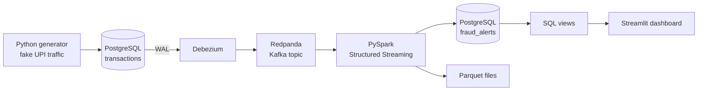

# Real-Time UPI Fraud Detection with CDC

A streaming pipeline that captures every database change from PostgreSQL using
Change Data Capture (CDC), scores each transaction for fraud in near real time
with PySpark Structured Streaming, and shows the alerts on a live dashboard.

## Architecture



## Fraud rules

| Rule | Logic |
|---|---|
| VELOCITY | More than 5 transactions from one user in the last 60 seconds |
| HIGH_AMOUNT | Amount above 5x the user's historical average and above 5,000 |
| NEW_DEVICE | Device not registered for the user and amount above 10,000 |

## Tech stack

PostgreSQL 16 (logical replication), Debezium 2.5, Redpanda, PySpark 3.5
(local mode), Streamlit, Docker Compose, Python 3.

## Run it

```bash
docker compose up -d
# create tables (users, devices, transactions, fraud_alerts) - see sql/ folder
# register the Debezium connector - see connector.json
pip install -r requirements.txt
python generator.py        # terminal 1: fake transactions
python spark_fraud.py      # terminal 2: fraud detection
streamlit run dashboard.py # terminal 3: dashboard at localhost:8501
```

## Dashboard


## Design notes

- Debezium reads the Postgres write-ahead log, so the app code never needs to publish events itself.
- `decimal.handling.mode=double` makes NUMERIC amounts readable in Spark.
- Built to run on an 8 GB laptop: Redpanda instead of Kafka + Zookeeper, Spark in local mode.

## Known limitations

- VELOCITY keeps flagging a user's normal transactions for up to 60 seconds after a burst.
- Rules are static thresholds, not a trained model.
- Single node, so no fault tolerance.

## Next steps

Delta Lake storage layers, Airflow orchestration, an ML anomaly score, and a SQL Server CDC version.
